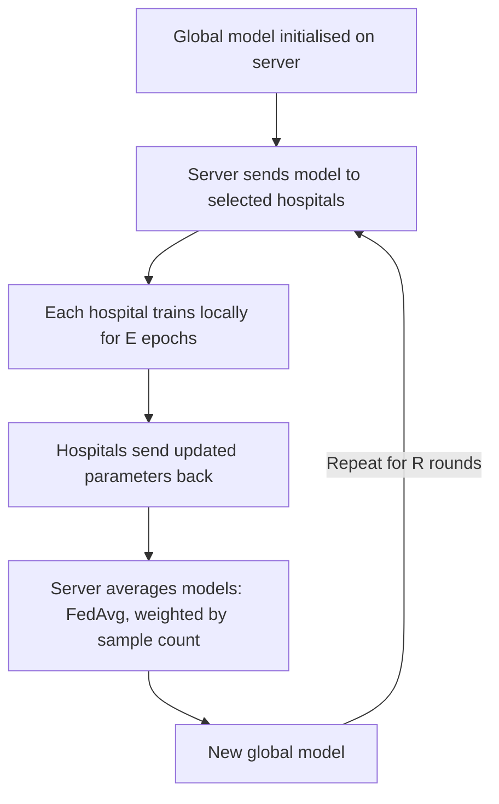

# Federated Diabetes Prediction with Flower + FedAvg

Train a diabetes prediction model **collaboratively across several simulated hospitals without sharing raw patient data**. Each hospital trains on its own local data and sends only model parameters to a central server. The server combines them with **Federated Averaging (FedAvg)** and sends the improved global model back. This repeats for multiple rounds.

The federation runs as **real, separate OS processes** (one server + one process per hospital) over gRPC using [Flower](https://flower.ai). Flower's simulation engine is used only for quick debugging.

---

## Table of Contents

- [Goals](#goals)
- [How Federated Learning Works Here](#how-federated-learning-works-here)
- [Tech Stack](#tech-stack)
- [Dataset](#dataset)
- [Project Structure](#project-structure)
- [Getting Started](#getting-started)
- [Data Pipeline](#data-pipeline)
- [Models](#models)
- [Running the Federation](#running-the-federation)
- [Experiments](#experiments)
- [Evaluation Metrics](#evaluation-metrics)
- [Default Hyperparameters](#default-hyperparameters)
- [Key Design Decisions](#key-design-decisions)
- [Results](#results)
- [Limitations](#limitations)
- [Team and Timeline](#team-and-timeline)
- [License](#license)

---

## Goals

We want to demonstrate that:

1. A federated model can approach the performance of a centralized model.
2. Raw data never leaves a client (privacy motivation).
3. We can observe how FedAvg behaves when hospitals have different data distributions (non-IID).

---

## How Federated Learning Works Here



### FedAvg update rule

```
w_global(t+1) = Σ_k ( n_k / n ) · w_k(t+1)
```

- `w_k`: weights from hospital *k* after local training
- `n_k`: number of training samples at hospital *k*
- `n`: total training samples across the participating hospitals

---

## Tech Stack

| Purpose | Tool |
|---|---|
| FL framework | Flower (`flwr`), real separate processes (simulation only for debugging) |
| Language | Python 3.10+ |
| Model / training | PyTorch |
| Data handling | pandas, numpy, scikit-learn |
| Plots | matplotlib (optionally seaborn) |
| Experiment config | YAML or `pyproject.toml` |
| Tracking | CSV logs per run (optional: TensorBoard / Weights & Biases) |

> **Note:** Flower's API has changed across versions (the newer `ServerApp` / `ClientApp` + `flwr run` style replaced the older `start_simulation`). Exact versions are pinned in `requirements.txt`; follow the Flower docs for the version you install.

---

## Dataset

**Primary:** `diabetes_binary_health_indicators_BRFSS2015.csv`

- 253,680 rows, 21 features, target `Diabetes_binary` (0/1)
- No missing values, all numeric
- About 86% negative / 14% positive (class imbalance)
- About 24k exact duplicate rows (removed before splitting)

**Optional secondary:** `diabetes_binary_5050split_health_indicators_BRFSS2015.csv` (balanced, ~70k rows) for quick sanity checks.

**Not used:** the 3-class `012` file (prediabetes is only ~1.8%), Pima (768 rows) and UCI symptom data (520 rows), which are too small to split across clients.

**Features:** `HighBP`, `HighChol`, `CholCheck`, `BMI`, `Smoker`, `Stroke`, `HeartDiseaseorAttack`, `PhysActivity`, `Fruits`, `Veggies`, `HvyAlcoholConsump`, `AnyHealthcare`, `NoDocbcCost`, `GenHlth`, `MentHlth`, `PhysHlth`, `DiffWalk`, `Sex`, `Age`, `Education`, `Income`.

Place the original CSVs in `data/raw/` (never edit them).

---

## Project Structure

```
fl-diabetes/
├── README.md
├── PROJECT_FLOW.md
├── requirements.txt
├── pyproject.toml / config.yaml
├── data/
│   ├── raw/                    # original CSVs (never edited)
│   ├── processed/              # cleaned train / global-test files
│   └── partitions/             # client_0.csv ... client_N.csv (or .npz)
├── src/
│   ├── data/
│   │   ├── load_clean.py       # load, dedupe, type checks
│   │   ├── split.py            # train / global test split
│   │   ├── preprocess.py       # scaling
│   │   └── partition.py        # IID / Dirichlet / feature-skew partitioning
│   ├── model.py                # model definition + get/set parameters
│   ├── train_eval.py           # local train() and test() loops
│   ├── centralized_baseline.py # upper-bound baseline
│   ├── local_only_baseline.py  # lower-bound baseline
│   ├── client_app.py           # Flower NumPyClient / ClientApp
│   ├── server_app.py           # Flower strategy (FedAvg) / ServerApp
│   ├── metrics.py              # accuracy, precision, recall, F1, AUC
│   └── utils.py                # seeding, logging, config loading
├── scripts/
│   ├── run_server.sh           # starts the server process
│   ├── run_client.sh           # starts one hospital: run_client.sh <id>
│   └── run_all.sh              # server + N clients, collects logs
├── experiments/
│   ├── run_iid.py
│   ├── run_noniid.py
│   └── run_ablations.py
├── results/
│   ├── logs/                   # per-round CSVs
│   └── figures/                # plots for the report
└── notebooks/
    └── eda.ipynb               # exploration of the dataset
```

---

## Getting Started

### Prerequisites

- Python 3.10+
- `git`

### Installation

```bash
git clone https://github.com/<your-username>/fl-diabetes.git
cd fl-diabetes

python -m venv .venv
source .venv/bin/activate        # Windows: .venv\Scripts\activate

pip install -r requirements.txt
```

Core dependencies: `flwr[simulation]`, `torch`, `pandas`, `numpy`, `scikit-learn`, `matplotlib`.

### Smoke test

Run Flower's tiny quickstart to confirm the install works before running the project.

---

## Data Pipeline

The order is always:

**load → dedupe → global test split → partition across clients → per-client train/validation split**

1. **Clean (`load_clean.py`)**: confirm shape, dtypes and no nulls; remove exact duplicate rows (about 253,680 → about 229,500); cast the label to int and binary features to int/float; save to `data/processed/`.
2. **Split (`split.py`)**: hold out a **20% global test set**, stratified on the label with the real class ratio kept. This set is never used for training or partitioning and is used only by the server to evaluate the global model each round.
3. **Preprocess (`preprocess.py`)**: scale continuous/ordinal columns (`BMI`, `GenHlth`, `MentHlth`, `PhysHlth`, `Age`, `Education`, `Income`) using fixed-range min-max scaling so no client needs another client's statistics. Binary columns stay 0/1. Scalers are never fit on test data.
4. **Partition (`partition.py`)**: split the remaining 80% across hospitals (default **5 clients**). Each client then splits its local data into train/validation (80/20).

### Partition modes (selectable by config)

| Mode | How | Purpose |
|---|---|---|
| IID | Random equal split | Best-case baseline |
| Label skew (non-IID) | Dirichlet(α) over the label, α in {0.1, 0.5, 1.0} (smaller = more skewed) | Hospitals with different diabetes prevalence |
| Feature skew (non-IID) | Group by Age bracket / Income / Sex | Hospitals serving different populations |

Unequal client sizes (some big, some small hospitals) are also supported as an option.

> The dataset has no `State` column, so partitions are **simulated**.

---

## Models

- **Model A (default start):** logistic regression (single linear layer + sigmoid). Simple, fast, easy to explain.
- **Model B:** small MLP, `21 → 64 → 32 → 1` (ReLU, optional dropout).
- **Loss:** `BCEWithLogitsLoss` with `pos_weight ≈ (#neg / #pos)` to handle class imbalance.
- `get_parameters(model)` returns a list of NumPy arrays and `set_parameters(model, params)` loads them (this is what Flower exchanges).

### Baselines

| Baseline | Description | Role |
|---|---|---|
| Centralized | Train the same model on all pooled training data, evaluate on the global test set | Upper bound |
| Local-only | Each hospital trains alone on its own data, evaluated on the global test set | Lower bound |

---

## Running the Federation

The server and every hospital run as their own OS process, communicating over gRPC (localhost first, so it can later move to multiple machines). Development uses insecure local mode; TLS is a production requirement.

### Debug first with simulation

Use Flower's simulation engine (single process) to verify the model, partitions and strategy before dealing with networking.

### Real separate processes

```bash
# Terminal 1: server (SuperLink + ServerApp / strategy)
bash scripts/run_server.sh

# Terminals 2..6: one process per hospital (SuperNode + ClientApp)
bash scripts/run_client.sh 0
bash scripts/run_client.sh 1
bash scripts/run_client.sh 2
bash scripts/run_client.sh 3
bash scripts/run_client.sh 4

# Or start the server and N clients together and collect logs
bash scripts/run_all.sh
```

Each client process reads **only its own partition file**, which is what makes the privacy story real.

> The exact commands depend on your pinned Flower version (the CLI and `flwr run` deployment flow differ between releases). Check the Flower docs for that version.

### Strategy configuration (FedAvg)

- `fraction_fit`, `fraction_evaluate`, `min_fit_clients`, `min_available_clients`
- `initial_parameters` so every run starts from the same global model
- `on_fit_config_fn` sends `local_epochs`, `lr`, `batch_size` to clients
- Weighted `fit_metrics_aggregation_fn` / `evaluate_metrics_aggregation_fn`
- `evaluate_fn`: server-side evaluation on the held-out global test set each round

### FedProx variant

FedProx adds a proximal term `(μ/2)·‖w − w_global‖²` to the local loss, using a frozen copy of the global weights received at the start of each round. Everything else stays identical so FedAvg vs FedProx is a fair comparison. Try μ in {0.001, 0.01, 0.1, 1.0}; μ = 0 reduces to FedAvg (a handy correctness check).

### Robustness check

Kill a client mid-round and confirm the server proceeds with the remaining clients (set `min_fit_clients` / `min_available_clients` sensibly).

Per-round results are saved to `results/logs/<run_name>.csv`.

---

## Experiments

Each experiment is repeated with **3 to 5 random seeds** and reported as mean ± std.

| ID | What varies | Question answered |
|---|---|---|
| E1 | Centralized vs FedAvg (IID) | How close does FL get to centralized? |
| E2 | IID vs non-IID (Dirichlet α) | How much does data heterogeneity hurt? |
| E3 | Local epochs (1, 3, 5, 10) | Effect of more local computation per round |
| E4 | Number of clients (3, 5, 10; counts above 5 via simulation) | Scalability |
| E5 | Client participation (`fraction_fit` 0.3, 0.5, 1.0) | Effect of partial participation |
| E6 | Model A vs Model B | Does a bigger model help in FL? |
| E7 | Local-only vs FedAvg | Benefit of federation |
| E8 | FedAvg vs FedProx (μ sweep), IID and non-IID | Does the proximal term help under heterogeneity? |

```bash
python experiments/run_iid.py
python experiments/run_noniid.py
python experiments/run_ablations.py
```

---

## Evaluation Metrics

Accuracy alone is misleading, since a model that always predicts "no diabetes" gets about 86%. We report:

- **Recall (sensitivity)**, the key clinical metric, since we do not want to miss diabetic patients
- Precision, F1, AUC-ROC (optionally AUC-PR)
- Confusion matrix
- Decision threshold tuning (default 0.5 vs one chosen for higher recall)
- Per-client performance (fairness: does the global model work equally well for every hospital?)
- Communication cost: rounds × parameter size

---

## Default Hyperparameters

| Parameter | Default |
|---|---|
| Number of hospitals (clients) | 5 |
| Rounds | 30 to 50 |
| Local epochs per round | 3 |
| Batch size | 64 |
| Optimizer | SGD (lr 0.01, momentum 0.9) or Adam (lr 1e-3) |
| Client fraction per round | 1.0 |
| Test split | 20% global holdout |
| Client validation split | 20% of local data |
| Dirichlet α (non-IID) | 0.5 |
| Seeds | 3 to 5 |

---

## Key Design Decisions

1. **The global test set stays on the server only.** It is a simulation artefact used to measure progress; in real life each hospital would evaluate locally.
2. **Same initial weights for every run** so comparisons are fair.
3. **Weighted averaging by sample count** (this is what FedAvg means, not a plain mean).
4. **Class imbalance is handled** with `pos_weight`, and we report recall / F1 / AUC instead of just accuracy.
5. **Deduplicate before splitting and partitioning**, otherwise the same row can land in both a client's train and test sets and inflate the numbers.

> **Caveat:** BRFSS features are coarse survey answers, so some duplicates may be different people with identical answers rather than data errors. We still drop them because leakage-free evaluation matters more than keeping them.

### Risks and mitigations

| Risk | Mitigation |
|---|---|
| Non-IID data makes FedAvg diverge or slow | Lower learning rate, fewer local epochs, try FedProx |
| Imbalanced classes lead to high accuracy, low recall | `pos_weight`, threshold tuning, report F1 / AUC |
| Flower API changes between versions | Pin the version, follow the matching docs |
| Simulation memory/CPU limits | Limit concurrent clients, use small models |
| Results not reproducible | Fixed seeds, saved configs, saved partitions |
| Data leakage via duplicates or scaler fit | Dedupe first, fit preprocessing on train only |

---

## Results

> _To be filled in after running the experiments._

| Setting | Accuracy | Precision | Recall | F1 | AUC-ROC |
|---|---|---|---|---|---|
| Centralized | – | – | – | – | – |
| Local-only (mean over clients) | – | – | – | – | – |
| FedAvg (IID) | – | – | – | – | – |
| FedAvg (non-IID, α = 0.5) | – | – | – | – | – |
| FedProx (non-IID, best μ) | – | – | – | – | – |

Figures are generated by script into `results/figures/`.

---

## Limitations

- Hospitals are **simulated** partitions of one survey dataset (there is no `State` column), not real institutions.
- BRFSS is self-reported survey data with coarse features.
- Local development runs use insecure gRPC; TLS is required for any real deployment.
- Differential privacy, secure aggregation and a dashboard are out of scope unless time remains.

---

## Team and Timeline

Team of 3, 1-month deadline.

| Week | Goal | Exit check |
|---|---|---|
| 1 | Setup, cleaned data, partitions, model, centralized baseline | 5 saved partitions, centralized numbers, Flower hello-world runs |
| 2 | Working FedAvg end to end with real separate processes | One command starts server + 5 clients and a full IID run finishes with per-round metrics |
| 3 | FedProx and all experiments | Results CSVs for E1 to E8 |
| 4 | Plots, report, demo, buffer | Final report, reproducible README, demo |

**Roles**

- **Member A:** data and baselines
- **Member B:** Flower and infrastructure
- **Member C:** model, FedProx and evaluation

**Team habits:** one Git repo with feature branches, small PRs, a shared `config.yaml` so everyone runs identical settings, and a short sync twice a week.

---

## License

Add your license here (e.g. MIT).

## Acknowledgements

- [Flower](https://flower.ai) federated learning framework
- CDC BRFSS 2015 Diabetes Health Indicators dataset
- McMahan et al., *Communication-Efficient Learning of Deep Networks from Decentralized Data* (FedAvg)
- Li et al., *Federated Optimization in Heterogeneous Networks* (FedProx)
